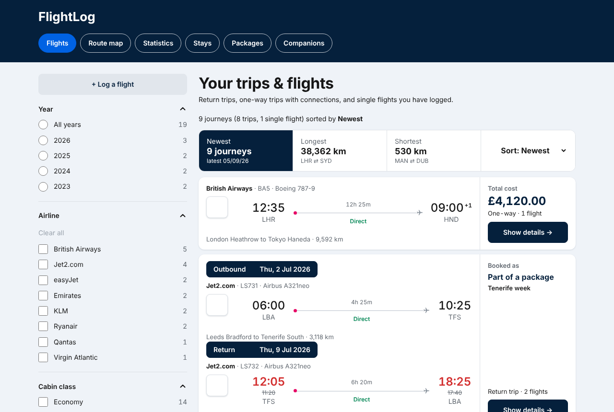
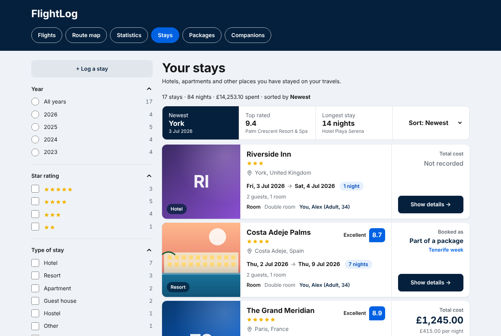
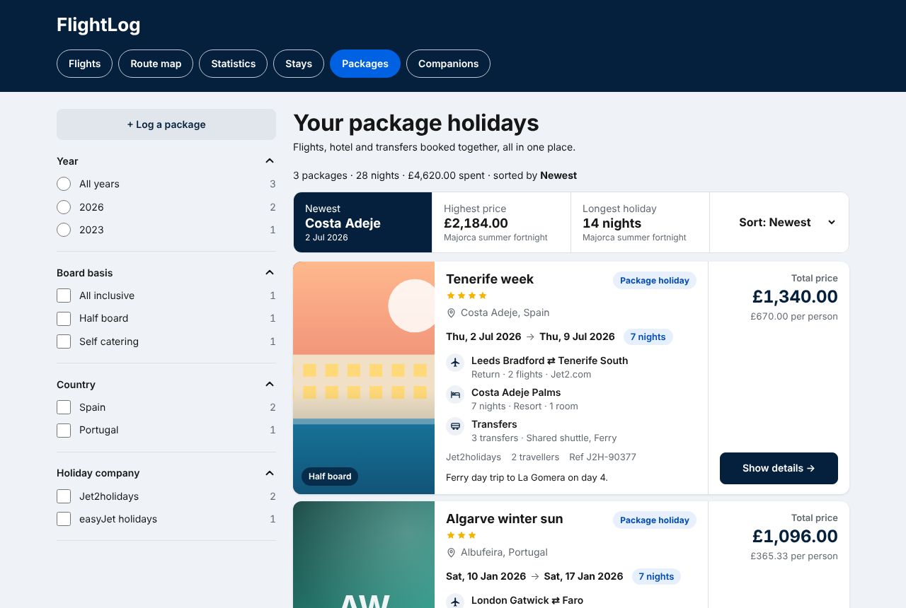
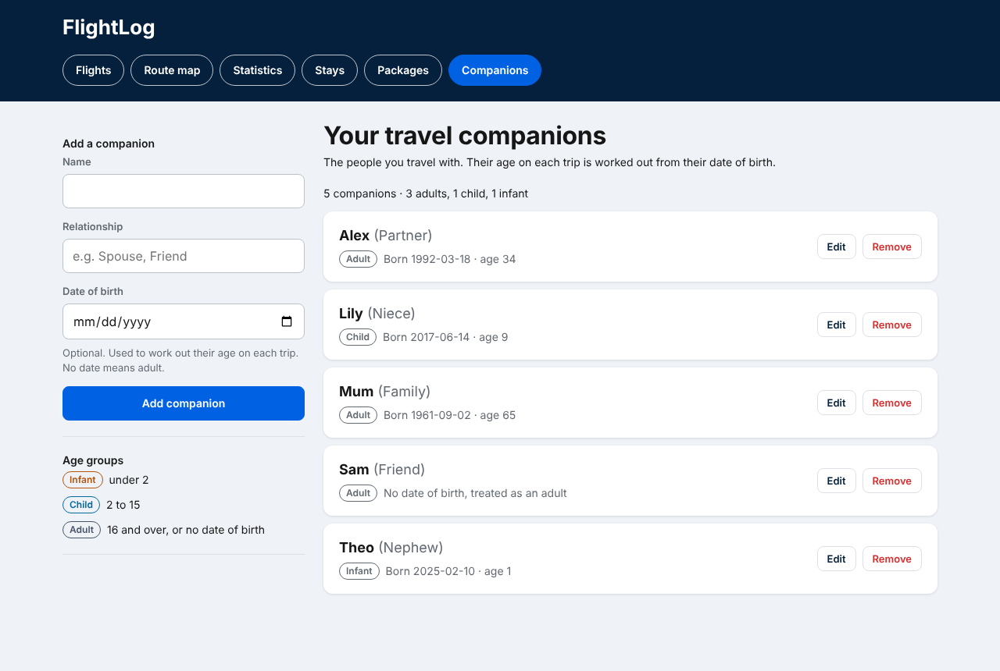

<div align="center">


### FlightLog

A self-hosted personal travel log for the flights you have taken, the places you stayed and the package holidays you have booked. One small container, one SQLite file, no external database.



</div>

## ✈️ Features

* **Flights**: log every flight with airport, airline, aircraft type, registration, cabin class, seat, times, delays and the total price. Shown as a search-results style list of flight cards, with filters for year, airline, cabin class and punctuality
* **Trips**: group outbound, return and connecting flights into one trip, with the time between connections
* **Stays**: hotels, apartments and other places you have stayed, with an optional hotel brand (also a filter on the Stays page), an address search and map pin, a photo, a 0 to 10 rating, rooms and who is in each one, and the cost
* **Packages**: bundle flights, a hotel and transfers into one package holiday with a single price. The package is named after its resort or destination ("Palma Nova trip"), and "Travelling With" works out the number of travellers and the adult / child / infant split. Tick **Free Child Place** and anyone who is a child (2 to 15) on the first day of the holiday travels free, with the price shared between everyone else. Convert an existing trip into a package in one click; flights and stays inside show "Part of a package" instead of a price
* **Travel companions**: record who you travel with, with an optional date of birth. Their age is worked out on each trip's travel date: infant (under 2), child (2 to 15) or adult (16 and over, or no date of birth)
* **Route map**: great-circle routes (antimeridian-safe) on a world map, centred on your home country
* **Statistics**: six tabs covering airlines and aircraft, places, flights and delays, spend, people and more. Flights and distance side by side, with a world map shading the countries you have visited
* **Reference data**: about 391 airlines with verified IATA codes and logos, and about 9,000 airports from OurAirports
* **Accounts**: a proper login page, and every person only sees their own data, with their own home country and miles or kilometres setting
* **Backup and restore**: one JSON file holds everything, and can also import just flights, stays or packages

<div align="center">
 

</div>

## 🚀 Getting Started

* [Deploy with Docker Compose, Portainer or TrueNAS](#deploying)
* [Configuration](#configuration)
* [Accounts](#accounts)
* [Backups and importing data](#backups-and-importing-data)
* [Updating](#updating)
* [Troubleshooting](#troubleshooting)

Already have Docker? The short version:

```bash
curl -O https://raw.githubusercontent.com/jackb1990/flightlog/main/docker-compose.yml
docker compose up -d
```

Open `http://localhost:8420`, choose **Create account**, pick your home country and miles or kilometres, then **Log a Flight**. FlightLog starts empty; no sample data is installed.

## 🤝 Contributing

Bug reports and ideas are welcome: please open an [issue](https://github.com/jackb1990/flightlog/issues). To work on the code, see [Project layout](#project-layout). Run the tests with `npm test` (Node 22.5 or newer) before opening a pull request.

## 🛠️ Build Status

[](https://github.com/jackb1990/flightlog/actions/workflows/docker.yml)

---

## Trips and single flights

Use the **One way / Return** toggle when logging. A one-way flight is stored as a single flight; add connecting flights to a journey, or log the flights out and back for a return trip, and FlightLog groups them into one trip. Trips show as one card on the Flights page, with a details page listing every leg and the time between connections.

## Deploying

FlightLog is published as a ready-made container image, `ghcr.io/jackb1990/flightlog:latest`, built automatically from this repository. You do not need to build anything or copy any source code: you only need a machine that can run Docker (a home server, NAS, mini PC or a VPS) and one small compose file.

**What you need**

* Docker with the Compose plugin (or a tool that runs compose files, such as Portainer)
* About 200 MB of disk space for the image, plus a little for your data
* A free port on the machine (`8420` by default)

Pick the method that suits your setup. All three run the same image and keep your data in the same place.

### Option 1: Docker Compose (command line)

1. Download the compose file into a new folder:

   ```bash
   mkdir flightlog && cd flightlog
   curl -O https://raw.githubusercontent.com/jackb1990/flightlog/main/docker-compose.yml
   ```

2. (Optional) Create a file called `.env` next to it to change any [settings](#configuration), for example:

   ```bash
   FL_PORT=8420
   FL_SIGNUPS=on
   ```

3. Start it:

   ```bash
   docker compose up -d
   ```

4. Open `http://localhost:8420` (or `http://YOUR-SERVER-IP:8420` from another device). `docker compose ps` should show the container as *healthy* after about 15 seconds.

### Option 2: Portainer

1. In Portainer choose your environment (usually **local**), then **Stacks → Add stack**.
2. Name it `flightlog` and choose the **Web editor**.
3. Paste in the contents of [`docker-compose.yml`](docker-compose.yml).
4. Under **Environment variables** you can optionally add any of the settings below. None are required.

   | Name | Example | What it does |
   |------|---------|--------------|
   | `FL_PORT` | `8420` | Port to open on your server (change it if it clashes with something else) |
   | `FL_SIGNUPS` | `off` | Stops anyone else creating an account once yours exists |
   | `FL_DATA` | `/mnt/tank/apps/flightlog` | Keep the database in a folder or dataset of your choice instead of a Docker volume |
   | `FL_PASSWORD` | *(a strong password)* | Creates an account for `FL_USER` with this password. Not needed: you can create your account on the login page |

5. Click **Deploy the stack**, then visit `http://YOUR-SERVER-IP:8420`. Under **Containers → flightlog** the container should show *healthy* after about 15 seconds.

### Option 3: TrueNAS SCALE (with Portainer)

Follow Option 2, with one extra step first if you want your database inside a dataset (so it is covered by your snapshots and backups). Without it, FlightLog uses a Docker volume and needs no preparation.

1. **Datasets → Add Dataset**, for example `tank/apps/flightlog` (preset *Apps* or *Generic*).
2. **Edit Permissions** on it: user **apps**, group **apps** (both are ID **568**), tick *Apply User / Apply Group*, then save.
3. When you deploy the stack, set `FL_DATA` to the dataset path, for example `/mnt/tank/apps/flightlog`.

### First run

FlightLog starts empty: no sample data is installed. Open it in your browser, choose **Create account**, pick a username and password, your **home country** and **miles or kilometres** (both can be changed later in **Settings**), then **Log a Flight**.

Once everyone who needs an account has one, set `FL_SIGNUPS` to `off` and redeploy so nobody else can register.

### Running it from outside your home

Passwords sent over plain `http://` can be read by anyone on the same network, which is fine on a home LAN. To reach FlightLog from the internet, put it behind a reverse proxy that provides HTTPS (Nginx Proxy Manager, Caddy or a Cloudflare Tunnel) and forward the `X-Forwarded-Proto` header so the login cookie is marked secure. FlightLog uses relative URLs, so it also works under a sub-path.

### Building the image yourself (optional)

If you would rather build from source than pull the published image, clone the repository and run:

```bash
git clone https://github.com/YOUR_GITHUB_USERNAME/flightlog.git
cd flightlog
docker compose -f docker-compose.build.yml up --build -d
```

## Accounts

* Anyone who can reach the app can create an account while sign-ups are on (the default). Each account is completely separate. Once everyone who needs one has signed up, set `FL_SIGNUPS` to `off`.
* Sessions last 30 days and are stored in a cookie that scripts on the page cannot read. Repeated wrong passwords are slowed down automatically.
* There is no password-reset email. If you forget a password on a one-person install, set `FL_USER` and `FL_PASSWORD` in Portainer and redeploy: that account's password is reset to the value you set.

## Updating

Your data lives in the Docker volume (or the folder set by `FL_DATA`), not in the container, so updating never touches it.

* **Docker Compose:** in the folder with your compose file, run `docker compose pull && docker compose up -d`.
* **Portainer:** open the stack → **Editor** → switch on **Re-pull image and redeploy** → **Update the stack**.

**Upgrading from the version without accounts:** your flights and companions are kept. If you had set `FL_PASSWORD`, the same username (`FL_USER`, default `flightlog`) and password now work on the new login page and that account owns your existing flights. If you had no password, the first account created on the login page takes over your existing flights, so create it yourself straight after updating.

## Backups and importing data

* **Settings → Backup & Restore → Download export** gives one JSON file with everything.
* Or snapshot/copy the dataset (or volume): the whole database is one file, `flightlog.db`.
* To restore: **Settings → Import file**. Tick *Replace existing data of the same kind* to wipe first; only the kinds of data in the file (flights, stays, packages) are replaced, so a file of hotels never wipes your flights.
* **Importing just stays or packages:** the same button accepts a file with only a `stays` list, only a `packages` list, or any mix with `flights`. A stay needs `name`, `check_in` and `check_out` (YYYY-MM-DD); `brand`, `city`, `country`, `lat`, `lon`, `stay_type`, `stars`, `rating`, `price`, `booking_ref` and `notes` are optional. Give each stay a fixed `id` and re-importing the file updates it instead of adding a copy. A package needs a `destination` (its name becomes "<destination> trip" unless you give a `name`) and can carry its own `stays` and `transfers` (`kind`, `mode`, `date`, `time`, `from_place`, `to_place`, `notes`):

```json
{ "stays": [ { "id": "rome-2025", "name": "Alpha Hotel", "check_in": "2025-05-01", "check_out": "2025-05-03", "city": "Rome", "country": "Italy" } ],
  "packages": [ { "name": "Rome break", "provider": "Jet2holidays", "price": 640,
                  "transfers": [ { "kind": "arrival", "from_place": "Fiumicino Airport", "to_place": "Alpha Hotel" } ],
                  "stays": [ { "name": "Alpha Hotel", "check_in": "2025-05-01", "check_out": "2025-05-04" } ] } ] }
```

---

## Configuration

| Variable | Default | Purpose |
|----------|---------|---------|
| `FL_PASSWORD` | *(empty)* | Optional: makes sure an account named `FL_USER` exists with this password |
| `FL_USER` | `flightlog` | Username used with `FL_PASSWORD` |
| `FL_SIGNUPS` | `on` | `off` stops new accounts being created (the first account is always allowed) |
| `FL_GEOCODING` | `on` | `off` turns off the address search on the Stays form (addresses can still be typed in). Searches are sent from the server to OpenStreetMap's Nominatim, so the text typed into the address box leaves your network |
| `FL_GEOCODER_URL` | *(OpenStreetMap Nominatim)* | Optional: the address search service to use instead, if it speaks the Nominatim search format |
| `PORT` | `3000` | Port **inside** the container (leave alone) |
| `DATA_DIR` | `/data` | Where `flightlog.db` is stored |
| `TZ` | `Europe/London` | Container time zone |

## Troubleshooting

| Symptom | Fix |
|---------|-----|
| `pull access denied` / `denied` when deploying | The image name in the compose file is wrong (it must be lowercase), or the publisher has not made the image public yet |
| Container restarts with `EACCES` / `unable to open database file` | The `FL_DATA` folder is not owned by user/group 568 (see Option 3) |
| `port is already allocated` | Set a different `FL_PORT` |
| Airport search finds only ~150 airports | The full dataset is missing from the image: check the **Actions** build log for the `curl` step |
| Airline logos blank | Logos are fetched from a public logo service and fall back to the airline name when offline |
| Portainer build error `mkdir /.docker: permission denied` | Only when building from source in Portainer: its `HOME` is unset. Use the prebuilt-image compose file instead |
| Address search on the Stays form says it is not available | The server cannot reach the address service. Open **Containers → flightlog → Logs** in Portainer and look for `address search via ... failed` (`ENOTFOUND` / `EAI_AGAIN` = DNS, `ETIMEDOUT` / `ENETUNREACH` = no internet from the container, `status 403` / `429` = blocked or rate limited). For DNS problems uncomment the `dns:` lines in `docker-compose.yml` (or set your NAS's DNS), then redeploy. FlightLog tries OpenStreetMap Nominatim and then Photon; to use your own service set `FL_GEOCODER_URL`. You can always type the address by hand |
| Blank page | Hard-refresh (Ctrl/Cmd + Shift + R). The page itself prints a message if its libraries failed to load |

## Project layout

```
server/index.js        API + static file server (Node 22 built-in SQLite, zero npm dependencies)
shared/core.js         distance + statistics maths, shared by the server and the browser
frontend/              Alpine.js single-page UI (hash routes: #/, #/map, #/stats ...)
tools/                 airport CSV converter (used by the Docker build)
tests/                 node --test suites (run with `npm test`); tests/support holds the in-memory API the UI tests use
Dockerfile             two-stage build; fetches Alpine, Leaflet and OurAirports
docker-compose.yml     the file you paste into Portainer
.github/workflows/     test + build + publish to ghcr.io
```

Run the tests locally with `npm test` (Node 22.5 or newer). To try the container locally: `docker compose -f docker-compose.build.yml up --build`.

## Acknowledgements

* Airport data: [OurAirports](https://ourairports.com/data/) (public domain)
* Map tiles: © [OpenStreetMap](https://www.openstreetmap.org/copyright) contributors
* Address search: [Nominatim](https://nominatim.org/)
* Maps: [Leaflet](https://leafletjs.com/). Interface: [Alpine.js](https://alpinejs.dev/)
* Airline logos are the property of their respective owners and are used only to identify the airline.
