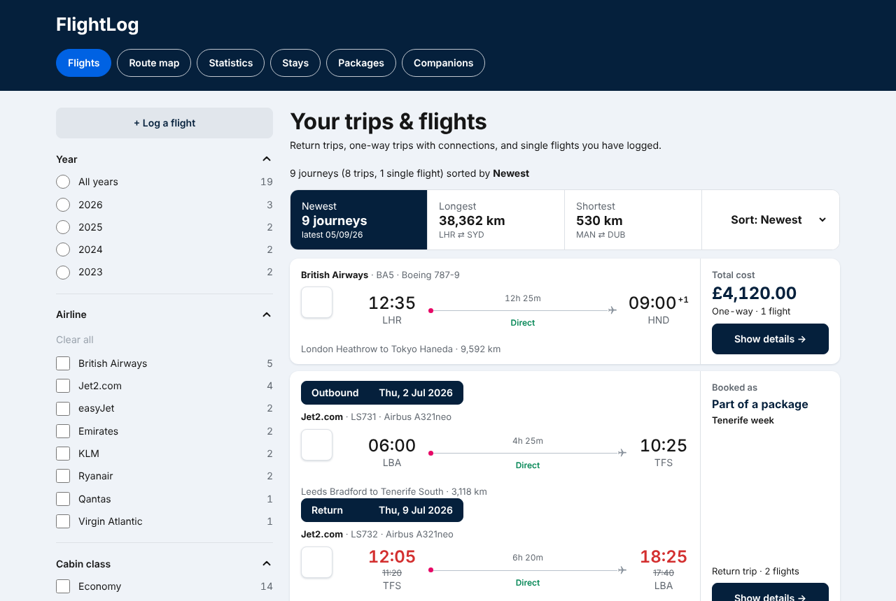
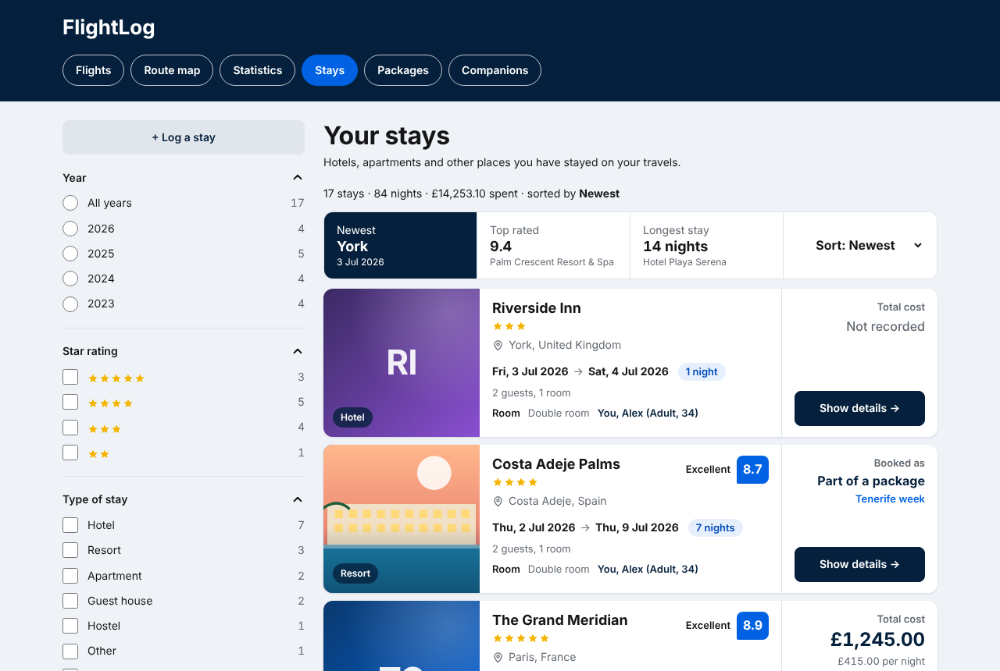
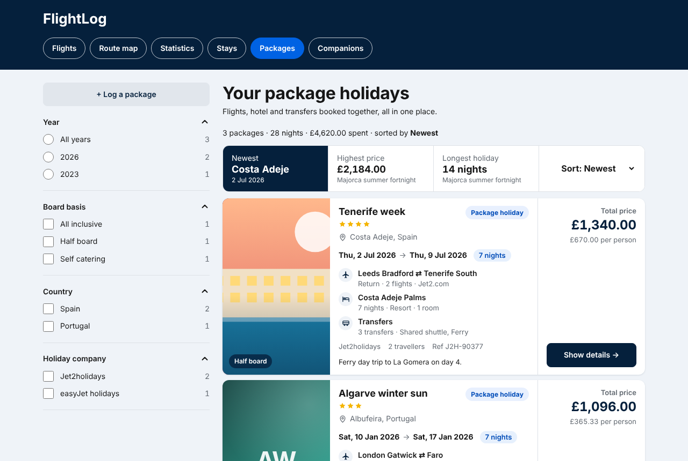
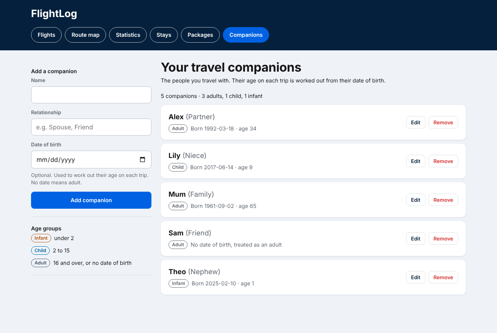

<div align="center">

[](https://github.com/YOUR_GITHUB_USERNAME/flightlog/releases)
[](https://github.com/YOUR_GITHUB_USERNAME/flightlog/pkgs/container/flightlog)
[](https://github.com/YOUR_GITHUB_USERNAME/flightlog/stargazers)


### FlightLog

A self-hosted personal travel log for the flights you have taken, the places you stayed and the package holidays you have booked. One small container, one SQLite file, no external database.



</div>

## ✈️ Features

* **Flights**: log every flight with airport, airline, aircraft type, registration, cabin class, seat, times, delays and the total price. Shown as a search-results style list of flight cards, with filters for year, airline, cabin class and punctuality
* **Trips**: group outbound, return and connecting flights into one trip, with the time between connections
* **Stays**: hotels, apartments and other places you have stayed, with an address search and map pin, a photo, a 0 to 10 rating, rooms and who is in each one, and the cost
* **Packages**: bundle flights, a hotel and transfers into one package holiday with a single price. Convert an existing trip into a package in one click; flights and stays inside show "Part of a package" instead of a price
* **Travel companions**: record who you travel with, with an optional date of birth. Their age is worked out on each trip's travel date: infant (under 2), child (2 to 15) or adult (16 and over, or no date of birth)
* **Route map**: great-circle routes (antimeridian-safe) on a world map, centred on your home country
* **Statistics**: six tabs covering airlines and aircraft, places, flights and delays, spend, people and more. Flights and distance side by side, with a world map shading the countries you have visited
* **Reference data**: about 391 airlines with verified IATA codes and logos, and about 9,000 airports from OurAirports
* **Accounts**: a proper login page, and every person only sees their own data, with their own home country and miles or kilometres setting
* **Backup and restore**: one JSON file holds everything, and can also import just flights, stays or packages

<div align="center">
 

</div>

## 🚀 Getting Started

* [Deploy with Docker Compose, Portainer and TrueNAS](#deploying)
* [Configuration](#configuration)
* [Accounts](#accounts)
* [Backups and importing data](#backups-and-importing-data)
* [Updating](#updating)
* [Troubleshooting](#troubleshooting)

Already have Docker? The short version:

```bash
curl -O https://raw.githubusercontent.com/YOUR_GITHUB_USERNAME/flightlog/main/docker-compose.yml
# replace YOUR_GITHUB_USERNAME in the file (lowercase), then:
docker compose up -d
```

Open `http://localhost:8420`, choose **Create account**, pick your home country and miles or kilometres, then **Log a Flight**. FlightLog starts empty; no sample data is installed.

## 🤝 Contributing

Bug reports and ideas are welcome: please open an [issue](https://github.com/YOUR_GITHUB_USERNAME/flightlog/issues). To work on the code, see [Project layout](#project-layout). Run the tests with `npm test` (Node 22.5 or newer) before opening a pull request.

## 🛠️ Build Status

[](https://github.com/YOUR_GITHUB_USERNAME/flightlog/actions/workflows/docker.yml)

---

## Trips and single flights

Use the **One way / Return** toggle when logging. A one-way flight is stored as a single flight; add connecting flights to a journey, or log the flights out and back for a return trip, and FlightLog groups them into one trip. Trips show as one card on the Flights page, with a details page listing every leg and the time between connections.

## Deploying

#### Step 1: Put the project on GitHub

1. Sign in at <https://github.com>, click **+ → New repository**.
   * Name: `flightlog`
   * Visibility: **Public** is simplest. Private works too, but see the note in Step 3.
   * Leave "Add a README" **unticked**. Click **Create repository**.
2. Upload the project. Pick **one** way:

   **A. Command line (recommended: it handles the hidden `.github` folder for you)**
   ```bash
   cd flightlog            # the unzipped project folder
   git init -b main
   git add .
   git commit -m "FlightLog"
   git remote add origin https://github.com/YOUR_GITHUB_USERNAME/flightlog.git
   git push -u origin main
   ```
   (GitHub will ask you to sign in; use a personal access token as the password if prompted.)

   **B. Browser upload**: on the empty repo page choose **uploading an existing file**, drag in *everything* from inside the project folder, then **Commit changes**.
   Make sure the hidden `.github` folder comes too (macOS Finder: press `Cmd + Shift + .` to show hidden files; Windows: it is visible by default). Without it, no image gets built.

#### Step 2: Let GitHub build the image

1. Open the repo's **Actions** tab. The workflow **Test and publish image** starts by itself on every push to `main`.
2. Wait for both jobs (`test`, then `publish`) to turn green. The first run takes roughly 5-10 minutes.
3. If it fails, open the failing step and send me the log.

#### Step 3: Make the image downloadable

GitHub packages start out private. On your GitHub profile click **Packages → flightlog → Package settings → Danger Zone → Change visibility → Public**.

> Keeping it private? In Portainer go to **Registries → Add registry → Custom**: URL `ghcr.io`, your GitHub username, and a personal access token with the `read:packages` scope.

#### Step 4: Prepare TrueNAS (optional but tidy)

By default the database lives in a Docker volume called `flightlog-data`, and no preparation is needed.

If you would rather keep it in a dataset (so it is covered by your snapshots and backups):

1. **Datasets → Add Dataset**, e.g. `tank/apps/flightlog` (preset *Apps* or *Generic*).
2. **Edit Permissions** on it: user **apps**, group **apps** (both are ID **568**), tick *Apply User / Apply Group*, save.
3. You will use its path, e.g. `/mnt/tank/apps/flightlog`, in the next step as `FL_DATA`.

#### Step 5: Deploy in Portainer

1. In Portainer choose your environment (usually **local**), then **Stacks → Add stack**.
2. Name: `flightlog`. Build method: **Web editor**.
3. Paste in the contents of `docker-compose.yml` and replace `YOUR_GITHUB_USERNAME` with your GitHub username in **lowercase**.
4. Scroll to **Environment variables → Add environment variable** and (recommended) add:

   | Name | Value | What it does |
   |------|-------|--------------|
   | `FL_PASSWORD` | something strong | Optional. Creates (or keeps) an account for `FL_USER` with this password. Not needed: you can create your account on the login page |
   | `FL_SIGNUPS` | `off` | Optional. Set to `off` after your accounts exist so nobody else can register |
   | `FL_PORT` | `8420` | Port on the NAS (change if it clashes) |
   | `FL_DATA` | `/mnt/tank/apps/flightlog` | Only if you made a dataset in Step 4 |

5. Click **Deploy the stack**.
6. Visit `http://YOUR-TRUENAS-IP:8420`. In Portainer, **Containers → flightlog** should show *healthy* after about 15 seconds.

FlightLog starts empty: no sample data is installed. On your first visit you will see the login page: choose **Create account**, pick a username and password, your **home country** and **miles or kilometres** (both can be changed later in **Settings**), then **Log a Flight**.

## Accounts

* Anyone who can reach the app can create an account while sign-ups are on (the default). Each account is completely separate. Once everyone who needs one has signed up, set `FL_SIGNUPS` to `off`.
* Sessions last 30 days and are stored in a cookie that scripts on the page cannot read. Repeated wrong passwords are slowed down automatically.
* There is no password-reset email. If you forget a password on a one-person install, set `FL_USER` and `FL_PASSWORD` in Portainer and redeploy: that account's password is reset to the value you set.

## Updating

Push a change to `main` and wait for the green build, then in Portainer open the stack → **Editor** → switch on **Re-pull image and redeploy** → **Update the stack**. Your data is untouched.

**Upgrading from the version without accounts:** your flights and companions are kept. If you had set `FL_PASSWORD`, the same username (`FL_USER`, default `flightlog`) and password now work on the new login page and that account owns your existing flights. If you had no password, the first account created on the login page takes over your existing flights, so create it yourself straight after updating.

## Backups and importing data

* **Settings → Backup & Restore → Download export** gives one JSON file with everything.
* Or snapshot/copy the dataset (or volume): the whole database is one file, `flightlog.db`.
* To restore: **Settings → Import file**. Tick *Replace existing data of the same kind* to wipe first; only the kinds of data in the file (flights, stays, packages) are replaced, so a file of hotels never wipes your flights.
* **Importing just stays or packages:** the same button accepts a file with only a `stays` list, only a `packages` list, or any mix with `flights`. A stay needs `name`, `check_in` and `check_out` (YYYY-MM-DD); `city`, `country`, `lat`, `lon`, `stay_type`, `stars`, `rating`, `price`, `booking_ref` and `notes` are optional. Give each stay a fixed `id` and re-importing the file updates it instead of adding a copy. A package needs a `name` and can carry its own `stays` and `transfers` (`kind`, `mode`, `date`, `time`, `from_place`, `to_place`, `notes`):

```json
{ "stays": [ { "id": "rome-2025", "name": "Alpha Hotel", "check_in": "2025-05-01", "check_out": "2025-05-03", "city": "Rome", "country": "Italy" } ],
  "packages": [ { "name": "Rome break", "provider": "Jet2holidays", "price": 640,
                  "transfers": [ { "kind": "arrival", "from_place": "Fiumicino Airport", "to_place": "Alpha Hotel" } ],
                  "stays": [ { "name": "Alpha Hotel", "check_in": "2025-05-01", "check_out": "2025-05-04" } ] } ] }
```

---

## Configuration

| Variable | Default | Purpose |
|----------|---------|---------|
| `FL_PASSWORD` | *(empty)* | Optional: makes sure an account named `FL_USER` exists with this password |
| `FL_USER` | `flightlog` | Username used with `FL_PASSWORD` |
| `FL_SIGNUPS` | `on` | `off` stops new accounts being created (the first account is always allowed) |
| `FL_GEOCODING` | `on` | `off` turns off the address search on the Stays form (addresses can still be typed in). Searches are sent from the server to OpenStreetMap's Nominatim, so the text typed into the address box leaves your network |
| `FL_GEOCODER_URL` | *(OpenStreetMap Nominatim)* | Optional: the address search service to use instead, if it speaks the Nominatim search format |
| `PORT` | `3000` | Port **inside** the container (leave alone) |
| `DATA_DIR` | `/data` | Where `flightlog.db` is stored |
| `TZ` | `Europe/London` | Container time zone |

Passwords sent over plain `http://` can be read by anyone on your network. That is fine for a home LAN. For access from outside, put it behind a reverse proxy with HTTPS (forward the `X-Forwarded-Proto` header so the login cookie is marked secure) (Nginx Proxy Manager, Caddy, Cloudflare Tunnel). The app uses relative URLs, so it also works under a sub-path.

## Troubleshooting

| Symptom | Fix |
|---------|-----|
| `pull access denied` / `denied` when deploying | Package is still private (Step 3), or the username in the YAML is wrong / not lowercase |
| Container restarts with `EACCES` / `unable to open database file` | The `FL_DATA` folder is not owned by user/group 568 (Step 4) |
| `port is already allocated` | Set a different `FL_PORT` |
| Airport search finds only ~150 airports | The full dataset is missing from the image: check the **Actions** build log for the `curl` step |
| Airline logos blank | Logos are fetched from a public logo service and fall back to the airline name when offline |
| Portainer build error `mkdir /.docker: permission denied` | Only when using `docker-compose.build.yml`: Portainer's `HOME` is unset. Use the prebuilt-image YAML instead |
| Blank page | Hard-refresh (Ctrl/Cmd + Shift + R). The page itself prints a message if its libraries failed to load |

## Project layout

```
server/index.js        API + static file server (Node 22 built-in SQLite, zero npm dependencies)
shared/core.js         distance + statistics maths, shared by the server and the browser
frontend/              Alpine.js single-page UI (hash routes: #/, #/map, #/stats ...)
tools/                 airport CSV converter (used by the Docker build)
tests/                 node --test suites (run with `npm test`); tests/support holds the in-memory API the UI tests use
Dockerfile             two-stage build; fetches Alpine, Leaflet and OurAirports
docker-compose.yml     the file you paste into Portainer
.github/workflows/     test + build + publish to ghcr.io
```

Run the tests locally with `npm test` (Node 22.5 or newer). To try the container locally: `docker compose -f docker-compose.build.yml up --build`.

## Acknowledgements

* Airport data: [OurAirports](https://ourairports.com/data/) (public domain)
* Map tiles: © [OpenStreetMap](https://www.openstreetmap.org/copyright) contributors
* Address search: [Nominatim](https://nominatim.org/)
* Maps: [Leaflet](https://leafletjs.com/). Interface: [Alpine.js](https://alpinejs.dev/)
* Airline logos are the property of their respective owners and are used only to identify the airline.
* README layout inspired by [AirTrail](https://github.com/johanohly/AirTrail)
